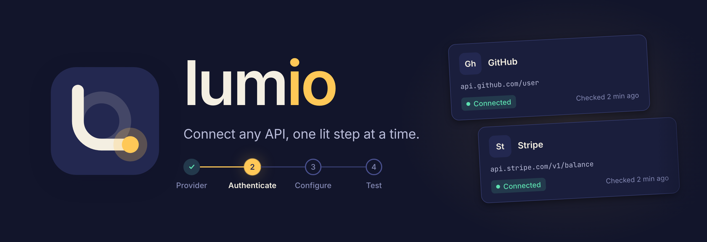
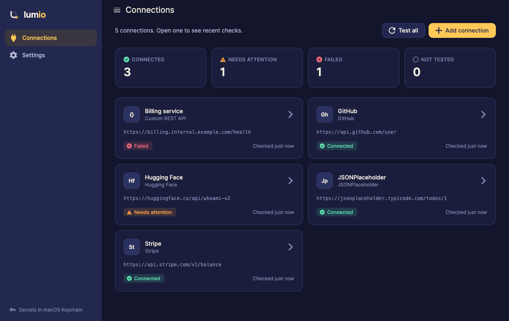
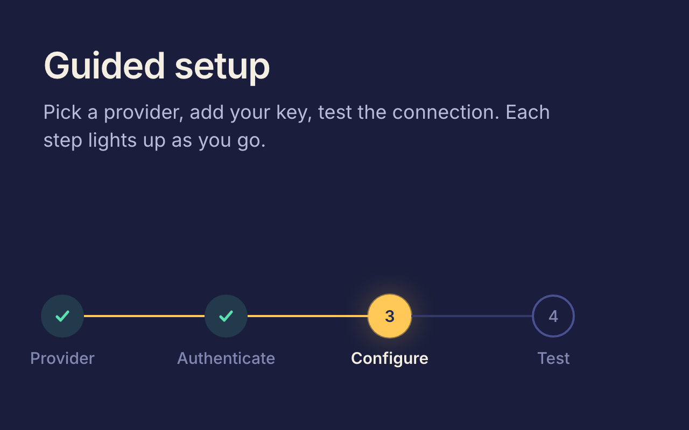
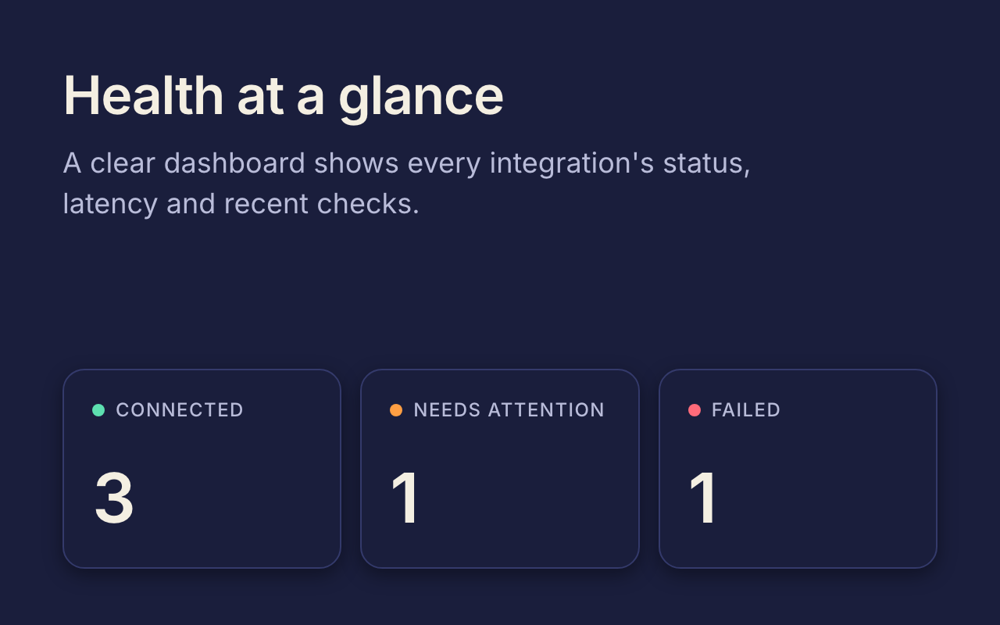
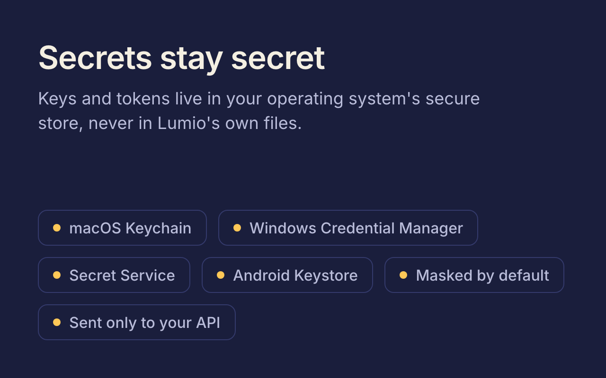
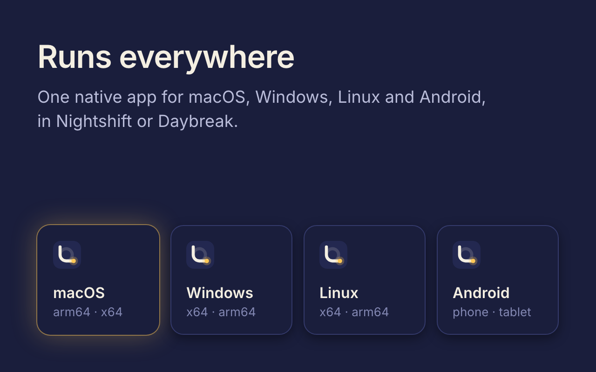
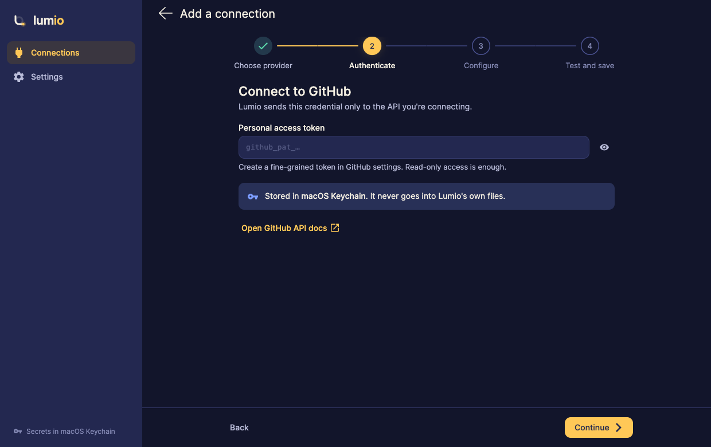
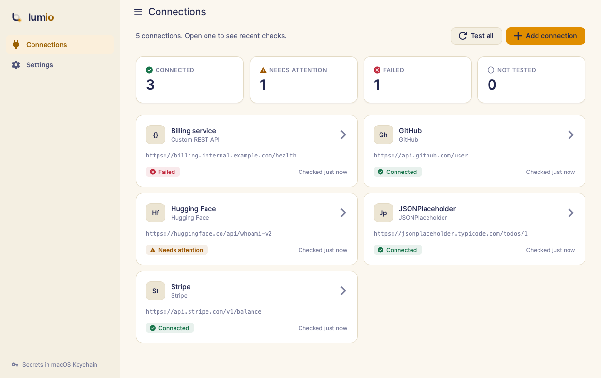
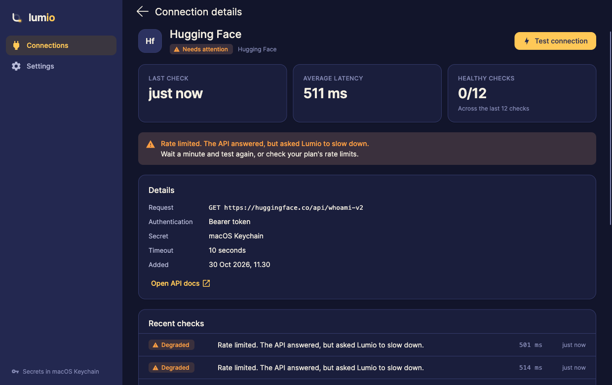
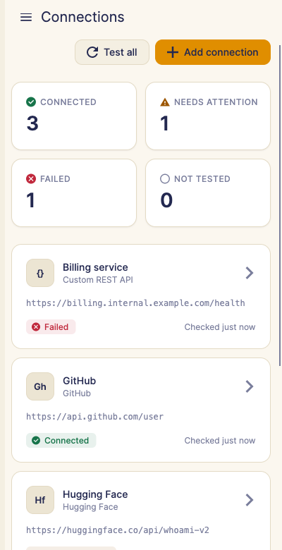

<div align="center">

<picture>
  <source media="(prefers-color-scheme: light)" srcset="docs/art/banner-light.png" />
  
</picture>

<br/><br/>

[](https://github.com/JonneNieminen/Lumio/actions/workflows/build.yml)
[](https://github.com/JonneNieminen/Lumio/releases)
[](LICENSE)

<br/>


[](https://dotnet.microsoft.com)
[](https://avaloniaui.net)
[](https://learn.microsoft.com/dotnet/communitytoolkit/mvvm/)
[](https://velopack.io)
[](.github/dependabot.yml)

Lumio makes connecting APIs simple. Instead of wrestling with docs and config files, you follow a guided flow:<br/>
pick a provider, add your key, test the connection. Each step lights up as you go, and a clear dashboard<br/>
shows the health of every integration. Your keys stay in your operating system's secure store.

<br/>



</div>

<br/>

<table>
  <tr>
    <td width="50%"><picture><source media="(prefers-color-scheme: light)" srcset="docs/art/card-guided-light.png" /></picture></td>
    <td width="50%"><picture><source media="(prefers-color-scheme: light)" srcset="docs/art/card-dashboard-light.png" /></picture></td>
  </tr>
  <tr>
    <td width="50%"><picture><source media="(prefers-color-scheme: light)" srcset="docs/art/card-secure-light.png" /></picture></td>
    <td width="50%"><picture><source media="(prefers-color-scheme: light)" srcset="docs/art/card-everywhere-light.png" /></picture></td>
  </tr>
</table>

## Features

- **Guided setup.** A four-step wizard (provider, authenticate, configure, test and save) with the right defaults for GitHub, Stripe, Hugging Face and JSONPlaceholder, or any REST API through *Custom*.
- **Every auth style.** Bearer tokens, API-key headers, HTTP Basic, or no auth at all.
- **Health dashboard.** Connected, needs attention, failed and untested at a glance, with one-click *Test all*.
- **Plain-language results.** Each check reports status, latency and what to do next ("The API rejected the key (401). Copy a fresh key and paste it again.").
- **History.** The last 20 checks per connection, with average latency and the healthy-check ratio.
- **Secrets stay secret.** Keys live in macOS Keychain, Windows Credential Manager, the Secret Service on Linux, or the Android Keystore. Lumio's own files hold no secrets, and secrets are masked by default.
- **Runs everywhere.** One native app for macOS, Windows and Linux (x64 and ARM) and Android. The layout adapts from wide windows to phones.
- **Nightshift and Daybreak.** Dark and light themes from the [Lumio design system](#design-system), or follow the OS, with a reduce-motion setting.
- **Self-updating builds.** Desktop releases are packaged with [Velopack](https://velopack.io), ready for delta updates from GitHub Releases.

<table>
  <tr>
    <td></td>
    <td></td>
  </tr>
  <tr>
    <td></td>
    <td align="center"></td>
  </tr>
</table>

## Install

Download the build for your device from [Releases](https://github.com/JonneNieminen/Lumio/releases/latest):

| Platform | File |
|---|---|
| **macOS** (Apple silicon / Intel) | `Lumio-x.y.z-osx-arm64.dmg` / `Lumio-x.y.z-osx-x64.dmg` |
| **Windows** (x64 / ARM) | `Lumio.Desktop-win-x64-Setup.exe` / `Lumio.Desktop-win-arm64-Setup.exe` |
| **Linux** (x64 / ARM) | the `.AppImage` from the `linux-x64` / `linux-arm64` channel |
| **Android** | `Lumio-x.y.z-android.apk` |

- **macOS**: open the `.dmg` and drag Lumio to Applications. The build isn't notarized yet, so run this once in Terminal (the DMG's *READ ME FIRST* has it ready to copy):
  ```bash
  xattr -dr com.apple.quarantine /Applications/Lumio.app
  ```
- **Windows**: run the installer. SmartScreen may warn about an unsigned app. Choose *More info → Run anyway*.
- **Linux**: `chmod +x` the `.AppImage` and run it. Secrets use `secret-tool` (package `libsecret-tools`).
- **Android**: allow installs from your browser or file manager, then open the `.apk`.

## Using Lumio

1. **Add a connection.** Choose *Add connection* and pick a provider. *Custom REST API* works with any HTTP API that has a health or status endpoint.
2. **Authenticate.** Paste the key or token. The wizard says where to find it and which scope is enough, and links to the provider's docs.
3. **Configure.** Check the base URL, the health path and the timeout. The provider's defaults are filled in.
4. **Test and save.** Lumio calls the endpoint, explains the result in plain words and saves the connection when you're happy.

Open a connection to test it again, see its last checks and average latency, read its request details or remove it. Removing a connection also deletes its secret from the secure store.

## Build from source

Requirements: the [.NET 10 SDK](https://dotnet.microsoft.com/download) (pinned in [`global.json`](global.json)). Android also needs the workload, a JDK 17+ and the Android SDK.

```bash
git clone https://github.com/JonneNieminen/Lumio.git && cd Lumio
dotnet run --project src/Lumio.Desktop          # run the desktop app
dotnet test --project tests/Lumio.Tests         # unit, view-model and headless UI tests
```

```bash
sudo dotnet workload install android
dotnet build src/Lumio.Android -t:Run           # run on a connected device or emulator
```

Debug builds include Avalonia DevTools. Tests use xunit v4 on Microsoft.Testing.Platform, and the UI tests run on Avalonia's headless platform.

## Architecture

```
Lumio.Desktop / Lumio.Android ──▶ Lumio (shell, pages, view models) ──▶ Lumio.Core (model, storage, secrets, HTTP checks)
   platform secret store            DrawerPage + NavigationPage            no UI references
   Velopack bootstrap               CommunityToolkit.Mvvm, MS DI      Lumio.Theme (tokens, styles, Stepper, StatusBadge)
```

| Project | What it holds |
| --- | --- |
| `src/Lumio.Core` | Domain model, provider catalog, JSON storage, secret stores, HTTP health checks. No UI references. |
| `src/Lumio.Theme` | The Lumio design system for Avalonia: generated tokens, Fluent palette mapping, control styles, `Stepper`, `StatusBadge`, `LumioMark`. |
| `src/Lumio` | App shell, pages and view models (CommunityToolkit.Mvvm, compiled bindings, MS DI). |
| `src/Lumio.Desktop` | Desktop head. Picks Keychain, Credential Manager or Secret Service. DevTools in Debug. |
| `src/Lumio.Android` | Android head with an Android Keystore secret store. |
| `tests/Lumio.Tests` | Tests for Core, view models and headless UI (theme tokens, stepper). |

Navigation uses Avalonia's `DrawerPage` + `NavigationPage`, driven view-model-first by `NavigationService` (explicit view mapping, trimming safe). The drawer is an inline sidebar on wide windows and an overlay on phones; pages adapt with container queries.

## Design system

Lumio's identity is *illumination*: a calm, dark-leaning interface where one warm light marks where to look next. The source of truth is `../lumio-theme/tokens.json` (Nightshift = dark, Daybreak = light). After changing it:

```bash
python3 ../lumio-theme/generate_theme.py && python3 tools/generate_avalonia_tokens.py
```

This rewrites `src/Lumio.Theme/Tokens/Tokens.g.axaml`: every token as `Lm<Name>Color` / `Lm<Name>Brush` per theme, shadows and glow as `BoxShadows`, and Fluent resource keys mapped to Lumio tokens.

| Asset | Source | Regenerate |
| --- | --- | --- |
| App icons (`assets/icons`) | Brand geometry | `python3 tools/generate_macos_icon.py` |
| README banners and cards (`docs/art`) | `design/banners/art.html` | `design/banners/render.sh` (needs Google Chrome) |

macOS 26+ draws legacy `.icns` icons on a grey plate, so the macOS icon is an Icon Composer document, `assets/icons/Lumio.icon`, which `build/macos/make-app.sh` compiles into the bundle's `Assets.car` with Xcode's `actool`. `lumio-icon.icns` remains as the macOS 11–15 fallback. Each Build uploads an `icon-preview-osx-*` artifact showing the icon as macOS renders it. To build the bundle locally with the new icon, Xcode needs its first-launch setup once: `sudo xcodebuild -runFirstLaunch`.

## CI and releases

| Workflow | When | What |
| --- | --- | --- |
| [Dependabot](.github/dependabot.yml) | Weekly, Monday | NuGet packages and .NET tools (Avalonia and Velopack/vpk grouped so they move together), the .NET SDK in `global.json` (minor and patch) and GitHub Actions. |
| [Build](.github/workflows/build.yml) | Push to main, PRs, manual | Tests, then self-contained builds for win-x64/arm64, osx-arm64/x64, linux-x64/arm64 and an Android APK, plus the macOS DMGs, as run artifacts. `Build result` is green only when every job passed. |
| [Release](.github/workflows/release.yml) | Manual (*Actions → Release → Run workflow*) | Picks the version (latest `vX.Y.Z` tag bumped by patch/minor/major, or an explicit version), tests, packs every desktop channel with Velopack (deltas from the previous release), builds the APK and DMGs, and publishes a GitHub release with install notes. |

The GitHub release is the update feed: each desktop channel (`win-x64`, `osx-arm64`, …) has its own `releases.<channel>.json`. In-app updating is the next step; `VelopackApp.Build().Run()` is already the first line of `Main`. Builds are unsigned for now, and `release.yml` marks where Windows, macOS and Android signing go.

The Velopack package id is `Lumio.Desktop`. Never change it, or installed apps stop finding updates. The `Velopack` NuGet package and the `vpk` tool (`.config/dotnet-tools.json`) must stay on the same version.

## Privacy & security

- Lumio talks only to the APIs you add, and only when you test them. No accounts, no telemetry.
- Secrets live only in the OS secure store (service `app.lumio`, account `connection.<id>`) and are sent only to the API they belong to.
- Connection settings and check history are in `connections.json` in the app data folder (`~/Library/Application Support/Lumio` on macOS, `%LOCALAPPDATA%\Lumio` on Windows, `~/.local/share/Lumio` on Linux).

Found a vulnerability? See [SECURITY.md](SECURITY.md).

## Contributing

Issues and pull requests are welcome. See [CONTRIBUTING.md](CONTRIBUTING.md).

## License

Lumio is [MIT](LICENSE) licensed. Built with [Avalonia](https://avaloniaui.net), [CommunityToolkit.Mvvm](https://github.com/CommunityToolkit/dotnet), [Velopack](https://velopack.io) and the [Inter](https://rsms.me/inter/) typeface.
